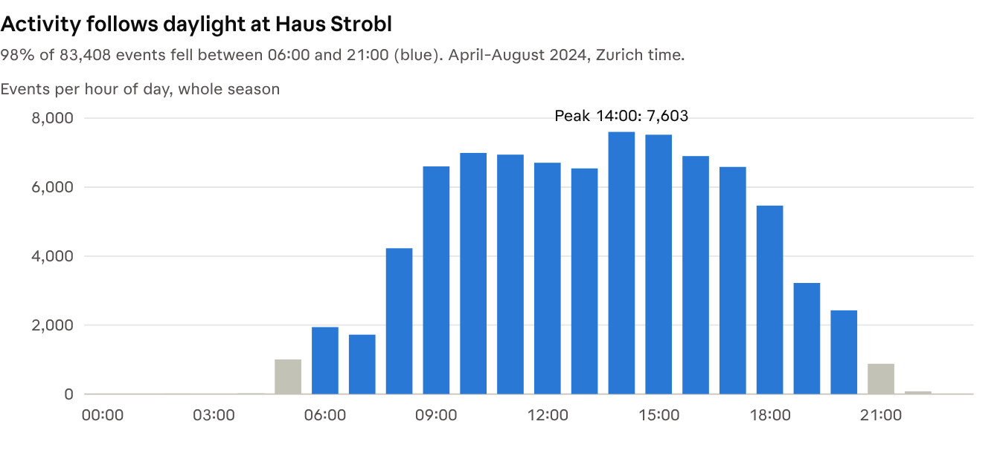

# SPAIA 2024 field deployment report

**Status:** Draft. Figures are from the database. Photos of the setup, sample captures and dashboard screenshots are still to be added (marked TODO).
**Period:** 1 April to 22 August 2024 (main outdoor unit: 18 April to 22 August 2024)
**Source:** SPAIA backend database, Neon project `SPAIA_Legacy_01`, queried 23 November 2026. All times are Europe/Zurich.
**Related:** [Ambassador radar and Pi camera tests](../hardware_experiments/ambassador_radar_and_pi_camera.md) (the device and its trigger), [radar-feasibility-2025](../radar-feasibility-2025/README.md) (the follow-up radar study).
**Shared doc:** https://claude.ai/artifact/4VDKMUZTPg1N4tPkNVuitM

---

## Summary

Between April and August 2024, SPAIA ran four camera-trap prototypes ("Ambassador" devices). Together they recorded **136,133 insect-trigger events**, each with a photo and a temperature and humidity reading. The main outdoor unit, at Haus Strobl in Walenstadt, ran across a **127-day season (18 April to 22 August 2024) and recorded data on 100 of those days**. It logged 83,408 events.

- **End-to-end pipeline proven in the field.** Detection, capture, upload and cloud storage ran unattended for months outdoors on a mountain meadow, and almost every event has its image and sensor reading stored.
- **The signal looks biological.** Events cluster in daylight, with 98% between 06:00 and 21:00 and a peak at 14:00–16:00. Daily counts rose about eightfold from April to August, in line with the insect season.
- **Annotation has started.** 1,313 events were marked verified and 2,010 regions were boxed on images. Mason bees (*Osmia*), flies (Diptera) and other Hymenoptera were the most frequent labels.
- **Gaps are documented.** There was one 22-day outage (18 June – 9 July). The temperature sensor measured the device, not the air, and less than 1% of events have been reviewed.

The result is a season-long, timestamped image dataset of real insect visits. It is the basis for training detection and classification models and for designing the next hardware generation.

## Deployments

Four devices, all of the same "Ambassador" type, reported to the SPAIA backend between 1 April and 22 August 2024.

| Device | First event | Last event | Days with data | Events | Marked verified |
|---|---|---|---|---|---|
| Haus Strobl (outdoor, Walenstadt) | 18 Apr 2024 | 22 Aug 2024 | 100 | 83,408 | 644 |
| Phänomena Office 1 | 2 Apr 2024 | 8 Jun 2024 | 40 | 50,134 | 660 |
| MotionLab | 1 Apr 2024 | 30 May 2024 | 15 | 2,276 | 6 |
| MotionLab 02 | 9 May 2024 | 31 May 2024 | 4 | 315 | 3 |
| **Total** | 1 Apr 2024 | 22 Aug 2024 | | **136,133** | **1,313** |

The two MotionLab units ran for short periods (4 and 15 days with data). The rest of this report focuses on Haus Strobl, the only unit that ran through the full summer. It stood in its 3D-printed enclosure, with no further shelter, in a flower meadow on a mountainside at Walenstadt (canton St. Gallen), powered from the mains.

TODO: photos of the Haus Strobl setup (device, mounting, surroundings).

<!--  -->

## Haus Strobl season

Activity rose steadily through the season, from about 220 events a day in April to more than 1,700 in August. The busiest single day was 4 August 2024, with 3,265 events.

| Month (2024) | Days with data | Events | Events per day with data |
|---|---|---|---|
| April (from 18th) | 12 | 2,639 | 220 |
| May | 29 | 12,731 | 439 |
| June | 17 | 12,773 | 751 |
| July | 22 | 20,541 | 934 |
| August (to 22nd) | 20 | 34,724 | 1,736 |

June and July have fewer days with data because of the outage from 18 June to 9 July.

Almost no events were logged at night. Counts climb from 05:00, stay high from 09:00 to 17:00 and peak in the early afternoon. This is the daily pattern expected from flying insects, and it suggests the trigger mostly responds to real visits, not to random image noise.

TODO: dashboard screenshots.

## System and method

Each Ambassador is a Raspberry Pi with a Pi camera and a Bosch BME280 temperature and humidity sensor. It photographs an insect when software on the device detects movement. The capture loop used in the 2024 field units works like this:

1. Stream 640×480 frames continuously and convert them to blurred greyscale.
2. Compare each frame with a stored reference frame and keep pixels that changed by more than 25 grey levels.
3. Find contours. Accept a contour between 20 and 1,000 pixels in area that doesn't touch the frame edge, which tunes the trigger to small objects.
4. Switch to 2304×1296 and take a still, then reset the reference frame.
5. Read temperature and humidity, then upload the event record and image to the SPAIA backend. Local copies are deleted.

Camera motion detection was the third trigger approach tried. A 60 GHz radar (Acconeer A111) was abandoned because environmental noise swamped it. An 8×8 time-of-flight sensor (ST VL53L7CX) was too coarse for small insects. The backend stores each event with its device, timestamp, image reference and sensor values in a Postgres database, along with any regions and labels added later during review.

The Haus Strobl unit was a Raspberry Pi 4 with the Raspberry Pi HQ camera, housed in a 3D-printed enclosure and running from mains power.

## Data collected and annotation

The 2024 dataset links every event to an image and to environmental readings. Manual annotation has covered a small sample so far.

| Record | Count | Notes |
|---|---|---|
| Trigger events | 136,133 | Timestamped, linked to a device |
| Images | 136,132 | One per event; one event has no image |
| Temperature readings (BME280) | 136,132 | One per event |
| Humidity readings (BME280) | 136,132 | One per event |
| Events marked verified | 1,313 | By 3 reviewers |
| Bounding-box regions | 2,010 | On 1,756 events |
| Labelled regions | 62 | 24 label names in the vocabulary |

Labels on Haus Strobl images, as recorded (47 labelled regions):

| Label | Regions |
|---|---|
| *Osmia* (mason bee) | 11 |
| Diptera (true flies) | 10 |
| Hymenoptera (bees, wasps, ants) | 8 |
| Garden slug | 7 |
| Ant | 3 |
| Fly | 3 |
| Bug | 2 |
| *Bombus* (bumblebee), Bombyliidae (bee flies), lizard, bee shadow, unidentified | 1 each |

The labelled sample already shows the range of visitors to the trap: solitary and social bees, flies, ants, and non-insect visitors such as slugs and a lizard. The label vocabulary mixes taxonomic ranks and has duplicate entries (Diptera appears five times). It needs consolidating before it is used for model training.

TODO: sample captured images, ideally one per main label.

## Limitations

The deployment proved the system works, but four limits affect how the numbers can be used.

- **Uptime.** Haus Strobl recorded data on 100 of 127 days (79%). Most of the loss is one outage from 18 June to 9 July (22 days). The other gaps are 1–2 days each. The June outage was not a device fault: the site manager unplugged the unit, and it ran again once power was restored.
- **Event count is not insect count.** An event is a motion trigger. One insect can trigger several events, and some triggers will be shadows, plants or other non-targets. Of the 1,313 events marked verified, none has a recorded yes/no outcome, so the true-positive rate is still unknown.
- **Sensor placement.** The BME280 read 35 °C on average and peaked at 49 °C, around 38 °C at midday. The sensor sat just inside the 3D-printed enclosure, next to the Pi 4, and the enclosure stood in full sun, so the readings show conditions inside the enclosure, not air temperature. The pressure channel was never recorded.
- **Small annotated sample.** 62 regions are labelled, against 136,133 events. That is enough to show what the trap captures but not to estimate species composition or detection accuracy.

## What this enables

The 2024 season leaves SPAIA with a working field pipeline, a large unlabelled image set and a clear list of hardware lessons. Each of these supports the next phase of R&D.

- **A training dataset.** 136,132 field images with timestamps and context, with 2,010 regions already boxed. Labelling a structured sample (for example, a few hundred events per month from Haus Strobl) would give the first labelled set for training an insect detector and classifier. It would also measure the true-positive rate of the motion trigger.
- **A seasonal activity baseline.** Daily and hourly counts from one site across April–August are a reference to compare future seasons, sites and trigger methods against.
- **Hardware direction.** The trigger work narrowed the field. Radar was swamped by outdoor noise, time-of-flight was too coarse, and camera motion detection worked. A go/no-go feasibility study with Fraunhofer IZM (completed March 2025) asked whether a 60 GHz radar could detect a target as small and fast as an insect at all. It could: 20 mm and 30 mm phantoms were clearly detected in an anechoic chamber. Further tests with IZM since then set up a more systematic method: establish clean readings in a controlled environment first, then use them to extract the insect motion signature from noisy field data. That method has not yet been tried in the field. Radar now needs further study and is a later-phase sensor, and the main track is the camera rig, including event-camera tests in 2026.
- **Design requirements for the next unit.** Move the temperature sensor outside the enclosure to a shaded spot, away from the Pi's heat, add uptime monitoring and alerts so a power loss like June 2024 is caught within a day, make the power connection harder to disconnect and clearly labelled, and record a verification outcome (insect or not) with each review.

## Sources

- SPAIA backend database, Neon project `SPAIA_Legacy_01` (tables `Events`, `EventMedia`, `SensorData`, `Regions`, `Labels`, `Label_Regions`, `Devices`). Queried 23 November 2026.
- [Ambassador, Raspberry Pi radar and camera trigger tests (2024 to 2025)](../hardware_experiments/ambassador_radar_and_pi_camera.md), built from the private SPAIA/ambassador repository.
- [Fraunhofer IZM radar feasibility study](../radar-feasibility-2025/README.md) (March 2025).
