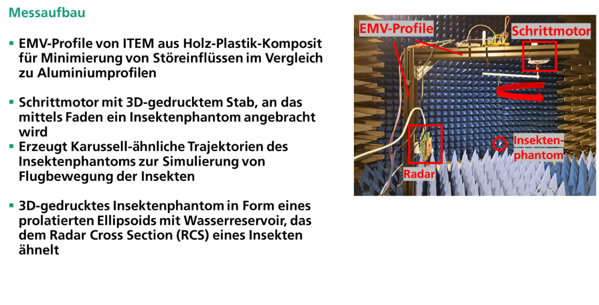
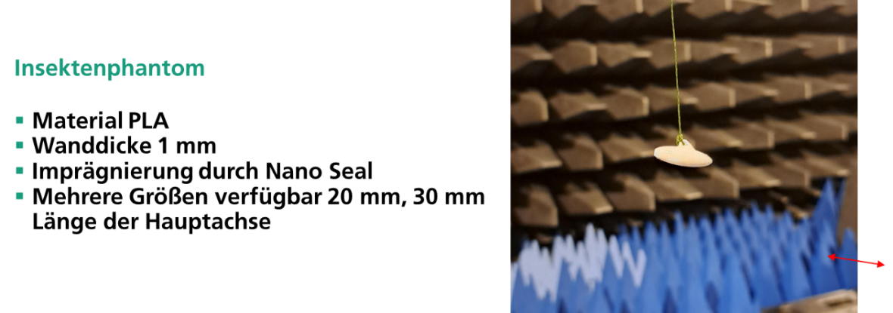
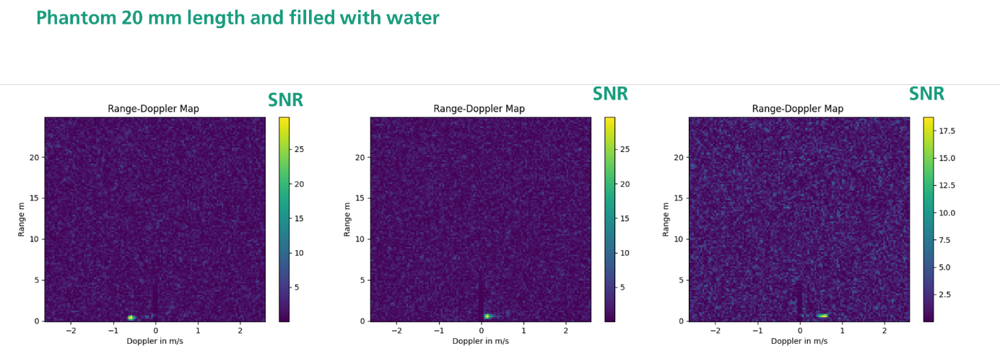
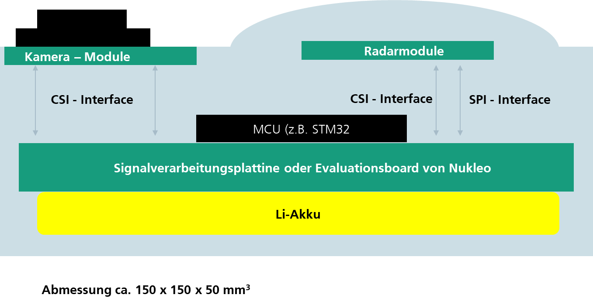

# 60 GHz Radar Feasibility Study with Fraunhofer IZM (2025)

**Status:** Completed March 2025. Radar is parked as a later-phase sensor, not part of the current reference rig.
**Partner:** Fraunhofer IZM, Department RF & Smart Sensor Systems (R3S), Group Radar Frontends & Modules (RFM)
**IZM contacts:** Dr.-Ing. Christian Tschoban (group manager), Raschid Younes (radar measurements)
**Funding:** IBB Transfer BONUS (Berlin), applied for and reported by Playstate UG
**Final report:** *Durchführbarkeit der Erfassung invasiver Insektenarten und Digitalisierungsansätze für die Datenübertragung*, Tschoban & Younes, dated 6 March 2025 (`Playstate_Abschlussbericht_br.docx`, German). Submitted to IBB as a PDF.

---

## Summary

SPAIA and Fraunhofer IZM ran a feasibility study on detecting insects with low-cost sensors. The main candidate was short-range radar. IZM built a measurement rig in an anechoic chamber and spun 3D-printed insect phantoms in front of the sensors. IZM's own **60 GHz FMCW MIMO radar module** clearly detected phantoms 20 mm and 30 mm long. The study ended with a concept for a compact camera + radar sensor node.

The report and emails never give a commercial part number for the radar. IZM described it as "one of our own" modules. Ask Raschid Younes or Christian Tschoban if you need the exact module or chipset.

## Requirements (from the kickoff workshop)

| Requirement | Target |
|---|---|
| Unit manufacturing cost | under €40 |
| Form factor | Compact, robust node that is easy to install at home or in a garden |
| Field of view | As wide as possible, ideally a whole garden |
| Biological parameters | Enough signal to assign detections to insect classes |
| Power | Low power, battery life over 2 years |

The original framing was detecting **invasive insect species**. The October 2025 follow-up looked specifically at Asian vs. European hornet.

## Sensor technologies compared

| Technology | Variants considered | Pros | Cons | Outcome |
|---|---|---|---|---|
| Radar | CW, FMCW | Low cost, works in any weather | Low horizontal resolution | **Taken forward** |
| Time-of-Flight | Separate and combined emitter/receiver | Low cost | Low horizontal resolution, strongly affected by weather | Taken forward, then limited |
| LiDAR | 1D LiDAR | Best horizontal resolution | High cost, strongly affected by weather | **Dropped** |
| Camera | Standard camera (already used by SPAIA), event camera | High resolution, low cost | Narrow field of view | Kept alongside radar |

## Measurement setup

- **Location:** RF anechoic chamber at Fraunhofer IZM, Berlin (nicknamed the "Death Star" internally).
- **Frame:** EMC-safe aluminium profiles holding a stepper motor overhead.
- **Target:** An insect phantom hung on a thread from the stepper motor and rotated in front of the sensor to imitate flight movement.
- **Sensor:** IZM 60 GHz FMCW MIMO radar board, mounted on the side of the frame facing the phantom.

The phantoms were 3D-printed, insect-shaped bodies **20 mm and 30 mm long**, filled with water to roughly match the dielectric properties of an insect body.

## Results

*Range-Doppler maps for the 20 mm water-filled phantom at three points in its rotation. The return sits below 1 m range, with Doppler shifting between about −0.6 and +0.6 m/s as the phantom swings. Peak SNR is about 25–30 in the first two frames and about 18 in the third.*

Findings from the report:

1. **Detection:** Both the 30 mm and 20 mm phantoms are clearly visible to the 60 GHz FMCW radar.
2. **Geometry:** SNR depends on the phantom's angle and distance relative to the radar.
3. **Scattering regime:** At 60 GHz (wavelength about 5 mm), insect-sized targets fall in the resonance (Mie) region. Expect large SNR swings with target size and orientation, not a smooth size-to-signal relationship.
4. **Species identification:** Not possible from these measurements. More work is needed before radar data can say anything about species.
5. **Camera and ToF alone:** Each had limits, mainly field of view and robustness to outdoor conditions. The team therefore decided to keep a camera module in the system alongside the radar.

## System concept

IZM sketched a first integrated node of about **150 × 150 × 50 mm**:

- **Camera module** over CSI.
- **Radar module** over CSI and/or SPI.
- **MCU:** STM32 family (CSI interfaces, on-chip AI accelerator, low power), on a custom signal-processing board or an ST Nucleo evaluation board for prototyping.
- **Power:** Li-ion battery with charging circuit on the signal-processing board.
- **Enclosure:** 3D-printed for early prototypes.

## Timeline

| Date | Event |
|---|---|
| Sep 2024 | Radar tests in the anechoic chamber planned and announced (spinning 3D-printed phantoms) |
| Feb 2025 | First radar results shared by Raschid Younes (screen recording / video, cleared for LinkedIn) |
| Feb 2025 | IGP feasibility-study proposal prepared jointly with IZM RFM |
| 6–7 Mar 2025 | Final report for IBB Transfer BONUS delivered and submitted |
| Mar 2025 | Follow-on Transfer BONUS discussed. IZM preferred to continue with the **camera**, because more radar work would amount to product development and not research. |
| Mar 2025 | KIBGI proposal (BMBF 2+2, with Chonnam National University and CoreIT) lists IZM as German academic partner |
| Apr 2025 | Second radar video from Raschid Younes |
| Oct 2025 | Sensor-selection follow-up with IZM, aimed at Asian hornet detection: radar (body size, velocity, wingbeat), Basler acA720-520uc high-frame-rate camera, Prophesee GenX320 event camera. ToF was later ruled out. |
| Feb–Mar 2026 | Camera measurements at IZM with the Basler and GenX320 (IZM radar again listed as "one of our own") |

## Where radar sits now

The main track is now the camera-based reference rig: Raspberry Pi 5, Basler global-shutter camera, and the GenX320 as a secondary feed. That work is documented in [`SPAIA/sensor_tests`](https://github.com/SPAIA/sensor_tests). Radar is parked as a later-phase sensor. The strongest candidate uses are:

- an **upward-pointing radar** to measure free-flying insects, including at night, which cameras miss;
- a **pond-side dragonfly / wetland module** as its own vertical.

When radar comes back, the plan is to use camera detections as labelled ground truth in the volume both sensors can see, then use radar to extend range beyond the camera.

## Open questions

- Exact module and chipset of the IZM 60 GHz FMCW MIMO radar (ask IZM).
- Detection floor below 20 mm. Later lab work reportedly reached about 6 mm. Confirm with IZM and record the measurement conditions.
- Performance outdoors with wind, vegetation clutter and multipath, none of which this study covered.
- Whether wingbeat micro-Doppler can be extracted at this frequency and bandwidth for functional-group classification.

## Sources

- Final report: *Playstate_Abschlussbericht_br.docx* (Fraunhofer IZM, 6 March 2025), emailed by C. Tschoban on 7 March 2025, thread "Scientific Report"
- Email threads with Raschid Younes: "Radar resluts" (21 Feb 2025), "Radar Video" (22 Apr 2025), "Exploring Further Collaboration & Transfer Bonus Opportunities" (Mar 2025)
- Email thread "Sensor Selection and testing" with C. Tschoban (Oct 2025 – Feb 2026)

*Figures are taken from the Fraunhofer IZM report. Check with IZM before publishing this page somewhere public.*
